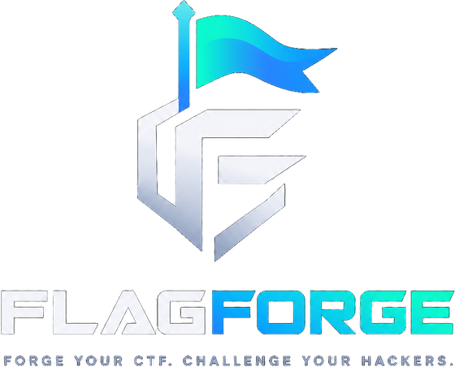

# FlagForge



A platform for creating and hosting Capture The Flag events. Organizers set up events and challenges, and players form teams and submit flags. (Built to the `ctf-builder` brief; the npm workspaces still carry that name.)

> **Status: complete.** The API, schema, login, teams, challenge CRUD with file attachments, flag checking, the player web app,
> the organizer dashboard, dynamic scoring and the live scoreboard are all done, with deployment and a load-testing harness.

## Stack

- **Server:** Node.js, TypeScript, Express 5
- **Database:** PostgreSQL 17 (schema and migrations via Drizzle ORM)
- **Cache and rate limiting:** Redis 7
- **Auth:** JWT (HS256) Bearer tokens, Argon2id password hashes
- **Real-time:** Socket.io, sharing the API's HTTP server
- **Clients:** React 19, Vite, React Router, react-markdown, socket.io-client
- **Uploads:** multer onto a local volume, served as downloads by the API
- **Tests:** Vitest and Supertest, run against real Postgres and Redis
- **Deployment:** Docker images for the API and both clients, behind nginx

```
client-admin/         Organizer dashboard (React + Vite), port 5173
  src/
    components/       Event form, challenge table, challenge editor, attachment manager, shared UI
    lib/              API client, hooks, types, formatting and the mirrored scoring curve
    pages/            Events, event (challenges + settings), login, 404
client-participant/   Player UI (React + Vite), port 5174
  src/
    components/       Challenge board, challenge dialog, team panel, scoreboard, rank graph, shared UI
    lib/              API client, socket feed, hooks, types, category and time helpers
    pages/            Events, event (challenges + team), scoreboard, login, 404
load/                 Load-testing harness (plain Node, no dependencies)
server/
  drizzle/            Generated SQL migrations
  src/
    db/               Schema, client, migrate and seed scripts
    lib/              Flag HMAC, password hashing, JWT, scoring formula, errors
    middleware/       Auth / role checks, Redis rate limiter, error handler
    routes/           auth, events, teams, challenges (player), scoreboard, admin
    services/         Shared event and team lookups, the Redis leaderboard, attachment storage
    realtime.ts       Socket.io server and the UPDATE_SCOREBOARD channel
  test/               API integration tests
```

## Getting started

Requirements: Node 22.12 or newer, and Docker.

```bash
npm install
cp server/.env.example server/.env
npm run services:up      # Postgres on localhost:5433, Redis on localhost:6379
npm run db:migrate
npm run db:seed          # demo accounts and "Demo Event"
npm run dev              # API on http://localhost:4000
npm run dev:participant  # in a second terminal: player UI on http://localhost:5174
npm run dev:admin        # in a third: organizer dashboard on http://localhost:5173
```

Postgres is mapped to host port **5433** so it doesn't clash with a locally installed PostgreSQL on 5432.

In development both clients proxy `/api` to the API, so no CORS setup is needed. For a build served from another origin, set `VITE_API_URL` (see each client's `.env.example`) and add that origin to `CORS_ORIGINS` on the server.

Challenge attachments are written to `UPLOAD_DIR` (`server/uploads` by default). They are not in the database, so a database backup alone does not restore them.

### Demo accounts

| Role   | Username | Password           |
|--------|----------|--------------------|
| Admin  | `admin`  | `admin-demo-pass`  |
| Player | `player` | `player-demo-pass` |

The seed creates a live **Demo Event** with 5 challenges (2 Web, 2 Crypto, 1 Forensics), one of which hands out a file. The player is already on **Demo Team**, up against three rival teams whose solves are spread over the first hour, so the scoreboard and its graph have a real race in them from the start. (Those teams' accounts are `rival1`–`rival3`, with the player password.) Passwords can be changed with `SEED_ADMIN_PASSWORD` and `SEED_PLAYER_PASSWORD`. Running the seed again resets the demo event, including its teams and solves.

### Tests

```bash
npm test          # server integration tests
npm run typecheck # server and both clients
npm run build     # production builds
```

The tests use a separate `ctf_test` database, created automatically when the Postgres volume is first initialized, and Redis DB 1.

## Organizer dashboard

The dashboard (`client-admin`, port 5173) is where an event is built. It signs in with an organizer
account — registration only ever creates players, so there is nothing to sign up for.

- **Events.** Your own events, live ones first. Creating one defaults to a two-day window starting
  on the next whole hour, and says in words how long that is. The settings tab renames an event,
  moves its window, or deletes it along with its challenges, teams, solves and files.
- **Challenges.** Grouped by category. Each row carries what the challenge is worth *right now*
  and how many teams have solved it, read from the same public scoreboard players see. Drafts are
  dimmed and dashed, so one look says what is actually live.
- **The editor.** Title, category, a Markdown description with a preview, the flag, and the three
  scoring numbers with the curve they produce spelled out: *worth 500 to the first team, 486 after
  5 solves, 329 after 15.* A publish toggle turns a draft into something players can see.
- **Attachments.** Upload the pcap, binary or archive a challenge needs, download it back to check
  it, or remove it. Files save as soon as they are chosen rather than when the form is submitted,
  because they are already on the server by the time they are listed.

Flags are write-only. The API never returns one, so the editor's flag field opens blank on an
existing challenge and leaving it blank keeps the flag that is set.

## Player interface

- **Events:** a public list sorted live, then upcoming, then ended, with live countdowns.
- **Sign in / create account:** registration makes a player account. Sessions are remembered in the browser and cleared if the token expires.
- **Team panel:** create a team or join one with an invite code, and share your code with a copy button. Solves are shared, so a teammate's solve shows as solved for everyone.
- **Challenge board:** filter by category (the filter is kept in the URL, e.g. `?category=crypto`), per-category solved counts, a progress bar and a "Hide solved" toggle.
- **Challenge files:** challenges that hand out a pcap, binary or archive list it in the dialog with its size. The API only serves attachments to signed-in players once the event has started, so the download goes through the session token rather than a plain link.
- **Challenge dialog:** the Markdown description (GitHub-flavored; raw HTML isn't rendered, so descriptions can't inject scripts) and the flag input, with clear feedback states:
  - **Correct**: success banner, and the card flips to solved.
  - **Incorrect**: the input shakes and is selected, ready to fix a typo.
  - **Already solved**: a teammate got there first.
  - **Rate limited**: a countdown from the server's `Retry-After`, with submit disabled until it ends. The limit is per player, so it applies across all challenges.
  - **Blocked**: explains why you can't submit (no team yet, or the event has ended).
- **Points on every card:** each challenge shows what it is worth right now and how many teams have solved it. Those numbers follow the live scoreboard feed, so they fall as other teams solve without a refresh. A correct submission answers with the points it earned.
- Before the event starts, the page shows a countdown and unlocks challenges automatically at the start time. Returning to the tab refreshes team and solve state.
- Organizer accounts see a note that they can't play, since the API only lets players join teams and submit flags.

## Scoreboard

The scoreboard lives at `/events/:eventId/scoreboard` and is **public** — spectators can watch without an account. It has three parts:

- **Score over time.** One stepped line per team (top 8, coloured by rank), drawn as inline SVG. Hovering reads every team's score at that moment, so overlapping lines stay legible. The standings table below it is the same data in text.
- **Standings.** Rank, team, solves, points and last solve. Rows slide to their new position when the order changes, and a score that just moved flashes. Your own row is highlighted, and ⚡ marks first bloods.
- **Challenge values.** What each challenge is worth now, how many teams have it, and who drew first blood.

Updates arrive over Socket.io: the server pushes the whole standings on connect and again after every solve, so there is no polling. If the socket can't connect the page still works — it falls back to what it loaded over HTTP, and the indicator says when the numbers are from.

## Game logic

### Scoring

Challenges use **dynamic scoring**: a challenge that everyone solves is not much of a challenge, so it is worth less.

```
value(n) = initialPoints + (minPoints - initialPoints) x (n / decay)^2     clamped to minPoints
```

`n` is the number of solves *after the first*, so the first team to solve never devalues it. The curve is flat at the start — the next few solvers lose very little — and a challenge the whole field clears bottoms out at `minPoints`. Organizers set `initialPoints` (default 500), `minPoints` (default 100) and `decay` (default 25) per challenge; setting `minPoints` equal to `initialPoints` gives a fixed-value challenge.

A challenge is worth the same to **every** team holding it, so a late solve pulls down the totals of teams that solved it earlier. That is deliberate: the scoreboard always reflects how hard each challenge turned out to be. Hidden challenges are worth nothing and are left out of the scoring entirely.

### Ranking

Teams are ranked on points, and ties are broken in favour of the team that got there first (earliest last solve). Both are packed into the single number a Redis sorted set orders by: `points x 2^22 - seconds since the event started`. The shift is larger than any possible point total's worth of seconds, so the tie-breaker can never eat into the points above it. Equal scores share a rank, and the next one skips ahead.

### The leaderboard cache

In the last minutes of a CTF the scoreboard is the most requested page there is, and recomputing every team's total from `submissions` per request does not hold up. A solve rebuilds the snapshot once and writes it to Redis:

| Key | Holds |
|-----|-------|
| `scoreboard:<eventId>:rank` | sorted set, `teamId` → packed score |
| `scoreboard:<eventId>:teams` | hash, `teamId` → that team's row |
| `scoreboard:<eventId>:meta` | challenge values, team count, revision |

A read is then a `ZREVRANGE` for the page of ranks plus one `HMGET`, and never touches Postgres. The write runs as one Lua script, so readers never see half a leaderboard, and a rebuild that started earlier but finished later can't overwrite fresher numbers — it carries a lower revision and is skipped. Postgres stays the source of truth: the cache expires after five minutes and any read can rebuild it.

The graph's lines are drawn with each challenge's **current** value, so they only ever climb. Replaying values as they changed through the event would make lines dip when another team solved something, which reads as a bug rather than as scoring.

## API

Authenticated requests send `Authorization: Bearer <token>`. Errors look like `{ "error": "message" }`. Validation errors also include `issues`.

### Auth

| Method | Path                 | Access | Notes |
|--------|----------------------|--------|-------|
| POST   | `/api/auth/register` | public | `{ username, email, password }` creates a **player** and returns `{ token, user }` |
| POST   | `/api/auth/login`    | public | `{ username, password }`. `username` can also be the email |
| GET    | `/api/auth/me`       | any user | |

### Events and teams (players)

| Method | Path | Notes |
|--------|------|-------|
| GET  | `/api/events` | Public list with `phase`: `upcoming`, `live` or `ended` |
| GET  | `/api/events/:eventId` | Public |
| POST | `/api/events/:eventId/teams` | `{ name }` creates a team and joins you to it. Returns `inviteCode` |
| POST | `/api/events/:eventId/teams/join` | `{ inviteCode }` |
| GET  | `/api/events/:eventId/teams/me` | Your team and its members |
| GET  | `/api/events/:eventId/challenges` | Published challenges with your team's `solved` state. Available once the event starts |
| POST | `/api/events/:eventId/challenges/:challengeId/submissions` | `{ flag }` returns `{ result: "correct" \| "incorrect" \| "already_solved" }`, plus `points` on a correct solve |
| GET  | `/api/events/:eventId/challenges/:challengeId/attachments/:attachmentId` | Downloads a challenge file. Published challenges only, once the event has started |

Challenges come back with `points` (what it is worth now), `solves` and `attachments`
(`{ id, filename, sizeBytes, createdAt }`).

### Scoreboard (public, no token)

| Method | Path | Notes |
|--------|------|-------|
| GET | `/api/events/:eventId/scoreboard` | Standings and challenge values. `?limit=` (default 100, max 500) |
| GET | `/api/events/:eventId/scoreboard/history` | One running total per team for the graph. `?limit=` teams (default 10, max 50) |

Both return 403 before the event starts. The Socket.io channel is the same data: connect to the API's origin with `?eventId=<uuid>` and listen for `UPDATE_SCOREBOARD`.

### Admin (organizer role, own events only)

| Method | Path |
|--------|------|
| GET, POST | `/api/admin/events` |
| GET, PATCH, DELETE | `/api/admin/events/:eventId` |
| GET, POST | `/api/admin/events/:eventId/challenges` |
| GET, PATCH, DELETE | `/api/admin/events/:eventId/challenges/:challengeId` |
| POST | `/api/admin/events/:eventId/challenges/:challengeId/attachments` |
| GET, DELETE | `/api/admin/events/:eventId/challenges/:challengeId/attachments/:attachmentId` |

A challenge body is `{ title, description (Markdown), category, flag, isHidden, initialPoints, minPoints, decay }`. Valid categories are `web`, `crypto`, `pwn`, `forensics`, `reverse` and `misc`. New challenges are **hidden** until you publish them with `isHidden: false`. Flags are write-only and never come back in any response. The scoring fields default to 500 / 100 / 25 and are explained under [Game logic](#game-logic).

Attachments are uploaded as `multipart/form-data` with a single `file` field, at most
`MAX_UPLOAD_BYTES` (25 MB) each and `MAX_ATTACHMENTS_PER_CHALLENGE` (10) per challenge. Two files
can't share a name on one challenge. Organizers can download their own to check them.

## Design notes

**Schema.** `users`, `events`, `teams`, `team_members`, `challenges`, `submissions` and `attachments`. The database itself enforces the rules that matter:
- Composite foreign keys on `(team_id, event_id)` and `(challenge_id, event_id)`. A submission or membership can't mix a team or challenge from one event with another event.
- `team_members` has the primary key `(event_id, user_id)`, so a player is on at most one team per event.
- A partial unique index `(team_id, challenge_id) WHERE is_correct` allows only one solve per team per challenge, even when teammates submit the flag at the same moment.
- Usernames, emails, team names and challenge titles are unique regardless of case, as are two files on one challenge.

**Flag checking.** Flags are stored as `HMAC-SHA256(FLAG_SECRET, flag)` and compared in constant time. A leaked database alone isn't enough to crack flags offline. Surrounding whitespace is trimmed, and flags are case-sensitive. Submissions are only accepted while the event is live, and only from players on a team.

**Brute-force protection.** A sliding-window rate limiter backed by Redis (a Lua script over a sorted set) allows `FLAG_RATE_LIMIT_MAX` submissions per user per window. It runs before any database work. Login and registration are limited per IP. Blocked requests get a `429` with a `Retry-After` header, which CORS exposes so browser clients can show a countdown.

**File uploads.** An attachment's bytes go to disk under a random 32-character `storageKey` the
server generates; the organizer's filename is stored only as data, for the download header. It is
never used as a path, so it can't traverse out of the upload directory or collide with another
file, and `safeFilename` strips separators and control characters out of it anyway. Downloads are
served from the upload directory as `root`, always as `application/octet-stream` with
`Content-Disposition: attachment` — the API origin is where session tokens live, and a file an
organizer uploaded must never be something the browser renders there.

The rows and the bytes are kept in step from both ends: an upload that fails validation takes its
file back out, and deleting a challenge or an event reads the storage keys *before* the rows
cascade away so the files can follow. The unlink runs after the rows are gone, so the worst case is
a file nothing points at rather than an attachment players can't download.

**Access control.** Registration always creates players, so admin accounts come from the seed script. Admin routes check the role and event ownership. Another organizer's event returns 404, not 403. Players can't see challenges before the event starts or while they're hidden. Every request loads the user fresh from the database, so a deleted account or role change takes effect immediately. The player UI hides what a user can't do, but the server makes every decision.

## Deployment

`docker-compose.prod.yml` builds and runs the whole platform: Postgres, Redis, the API, and nginx
in front of each client. Players land on `:8080` and organizers on `:8081`; nginx proxies `/api`
(and the Socket.io upgrade) to the API from the same origin, so neither client needs `VITE_API_URL`
and there is no CORS to configure.

```bash
cp .env.prod.example .env.prod          # then put real secrets in it
docker compose -f docker-compose.prod.yml --env-file .env.prod up -d --build
docker compose -f docker-compose.prod.yml --env-file .env.prod run --rm api node server/dist/db/migrate.js
```

Things that matter in production:

- **Secrets.** `JWT_SECRET` and `FLAG_SECRET` must be real random strings of at least 32
  characters; the server refuses to start otherwise. Changing `FLAG_SECRET` invalidates every
  stored flag, so set it once, before the first challenge.
- **Attachments.** The API writes them to `/data/uploads`, which the compose file keeps in a named
  volume. A container's own filesystem does not survive a redeploy, and a database backup alone
  does not bring the files back — back up the volume too.
- **Behind a proxy.** `TRUST_PROXY=true` is set so `req.ip` is the client's address and not
  nginx's, which is what the per-IP login limiter counts.
- **Organizer accounts.** Registration only ever creates players. The first organizer comes from
  the seed script (`node server/dist/db/seed.js` in the image, `npm run db:seed -w server` from a
  checkout), or from an `INSERT` with `role = 'admin'`.
- **One API process.** Socket.io pushes are in-process, so more than one API replica needs the
  Redis adapter wired up first. One process handled the load below comfortably.

Both clients are plain static builds (`npm run build -w client-participant`), so they can equally
go on any static host; point them at the API with `VITE_API_URL` and add their origins to
`CORS_ORIGINS`.

## Load testing

`load/run.mjs` is a dependency-free harness that builds a throwaway event, fills it with teams and
solves, and measures the two paths that decide whether a CTF survives its own final minutes.

```bash
npm run load                                             # 25 teams, 10 challenges, 50 readers
node load/run.mjs --teams 50 --readers 100 --seconds 20
node load/run.mjs --url https://ctf.example.com --keep
```

It deletes the event it created unless you pass `--keep`. The server's brute-force limits will
throttle a run of any size, which is the point of having them — raise `AUTH_RATE_LIMIT_MAX` and
`FLAG_RATE_LIMIT_MAX` on the target first, and the script says so plainly if it gets a `429`.

Against a production build on one laptop (Node 24, Postgres and Redis in Docker, 50 teams × 12
challenges = 600 solves, then 100 concurrent readers for 20s):

| Path | Requests | p50 | p95 | p99 | Throughput |
|------|---------:|----:|----:|----:|-----------:|
| Flag submission (insert, full leaderboard rebuild, socket push) | 600 | 158 ms | 208 ms | 229 ms | — |
| Scoreboard read (Redis only) | 13,789 | 141 ms | 186 ms | 269 ms | 686 req/s |

No failures and no rejected solves in either phase. The read path's latency is queuing, not work:
at 5 concurrent readers the same endpoint answers in 9 ms p50. 686 req/s is where one Node process
tops out on this machine, and that is the number to scale horizontally — which needs the Socket.io
Redis adapter first, as above.

Worth reading from the write-path figure: each of those 600 solves rebuilt the *entire* leaderboard
and pushed it to every connected client, and the slowest still answered in 291 ms. The rebuild is
one Lua script, so a reader never sees half a leaderboard.

## Roadmap

- [x] **Week 1: Core Engine.** Schema, user and team auth, admin challenge CRUD, flag checking endpoint and rate limiting
- [x] **Week 2: Player Interface.** Challenge list with category filter, submission input, correct/incorrect feedback
- [x] **Week 3: Real-Time Scoreboard.** Dynamic scoring, Redis sorted-set leaderboard, Socket.io push, rank-over-time graph
- [x] **Week 4: Polish and Deployment.** Organizer dashboard (`client-admin`), file uploads for attachments, Docker deployment, load testing
